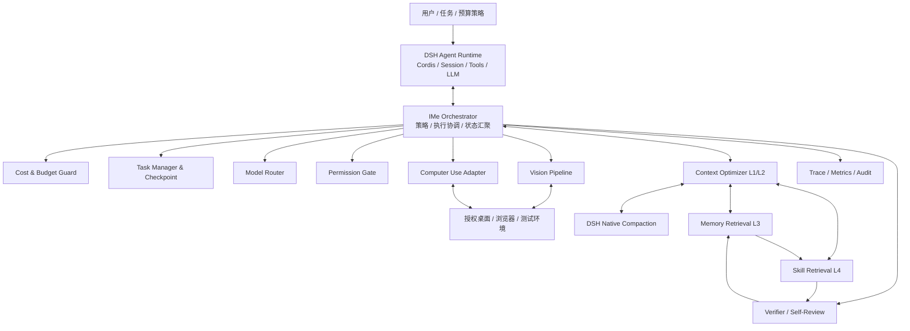
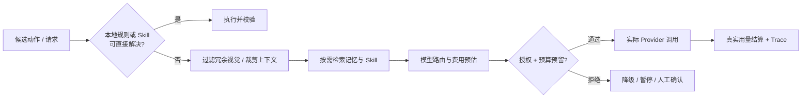

# IMe（Intelligent Memory & Execution）插件开发设计说明书

> **版本：** v1.0（开发基线草案）  
> **日期：** 2026-11-04  
> **目标平台：** DeepSeek Harness（DSH）/ Cordis 插件体系  
> **交付对象：** 架构师、插件开发工程师、前端工程师、测试工程师  
> **状态：** 可进入技术预研与任务拆分；发布前需完成 DSH 目标版本接口适配验证  
> **实现状态（2026-11-05）：** 学习/经验累积的实现对照与剩余缺口见 [docs/learning.md](docs/learning.md)；本设计书仍是目标设计，不代表全部条目已验收。

## 0. 执行摘要与关键决策

**产品定位：** IMe 是一个运行在 DSH 中的本地优先 Agent 增强插件。它让 Agent 在受控环境中“观察 → 规划 → 执行 → 验证 → 经验提炼 → 长期保存 → 跨会话复用”，并把 Token、视觉、模型重试和自审开销纳入统一预算。

**首版的核心原则：** 不重写 DSH Agent Loop，不重复实现原生 Compaction，不直接把第三方插件仓库拼接在一起。使用 Cordis 服务/事件/工具扩展点，面向既有 Computer Use Provider、视觉采集组件、模型适配器建立薄的适配层。IMe 自己拥有策略、预算账本、任务状态、记忆与 Skill 的管理权。

| 设计决策 | 结论 | 理由 |
| --- | --- | --- |
| 部署模式 | 本地优先、单机单用户 MVP | 降低持久化、权限和桌面互斥的复杂度 |
| 插件语言 | TypeScript / Node.js，与 DSH 同生态 | 方便复用 Cordis 扩展点 |
| 持久化 | SQLite（结构化状态）+ JSONL（审计）+ 文件（Skill 与可选截图） | 易备份、可迁移、可查询 |
| 桌面操作 | 复用一个现有 Provider；IMe 不重复注册 Provider | DSH Computer Use 只支持一个激活 Provider 槽位 |
| 视觉方案 | 本地事件筛选 + ROI + 关键帧；LLM 视觉按需调用 | 把省成本放到模型调用前 |
| 上下文方案 | 复用 DSH Compaction，叠加 L1–L4 分层检索/注入 | 压缩上下文不应等同于删除历史记忆 |
| 技能演化 | 候选 → 验证 → 发布 → 监控 → 修订/回滚 | 防止一次偶然成功形成长期错误技能 |
| 预算控制 | 请求前预留、请求后结算；硬预算必须在实际模型入口约束 | 仅凭 Hook 提示或 UI 告警不能防超支 |
| 安全边界 | 默认最小权限；对关键操作审批；长期记忆不可改写系统策略 | 防止模型和外部 UI 文本越权 |

**非目标（V1 不做）：** 模型权重微调、自主训练基础视觉模型、云端多租户、自动跨设备同步、绕过软件/游戏服务条款的操作、无人监管的高风险支付或文件删除。

## 1. 需求背景与用户场景

### 1.1 目标问题

传统 Computer Use Agent 在每次重开会话时重复识别界面、重复探索操作、重复消耗大量视觉 Token，且不一定知道失败是否源于环境变化。IMe 需要把“过程”转为“能可靠复用的能力”，同时使每一步的费用可预测、可追踪、可限制。

### 1.2 典型场景 A：首次探索与第二次复用

1. 用户在授权的测试应用/游戏模拟器中要求“找到任务面板并查看当前任务”。
2. Vision Engine 采样关键画面；Planner 将目标分解为若干动作；Computer Use Provider 执行；Verifier 确认目标面板出现。
3. 若操作成功，Memory 保存环境、动作、证据、结论；Skill Builder 生成候选技能，并注明按键映射、UI 版本、分辨率、语言与前置条件。
4. 在独立重启后的新会话中，Task Manager 检索该 Skill；如果前置条件满足且验证通过，则直接复用，不再从零学习。
5. UI 变化导致失败时，立即停止原序列并重新观察；回滚或降级该 Skill，而非无限重试。

> 《魔兽世界》可以作为需求灵感，但正式线上游戏的自动化可能违反服务条款。IMe 的端到端验收使用自建模拟 UI、离线测试应用或明确授权的环境。

### 1.3 典型场景 B：长任务与断点恢复

用户运行 60–120 分钟的跨窗口任务；IMe 每个关键动作后保存检查点。意外退出后，恢复“目标、已确认完成的步骤、未完成动作、所处界面、权限与预算余额”，再经环境重新验证后继续执行。**不能未经验证地自动重放上一次可能已经生效的不可逆动作。**

### 1.4 成功指标（初始目标，需实测校准）

| 指标 | MVP / V1 验收建议 | 测量方法 |
| --- | --- | --- |
| 单次请求计费可追溯 | 100% 进入账本，未知费用显式标记 | Provider usage 与持久审计对账 |
| 预算硬限制 | 在已知价格/输出上限条件下，零超预算的新增请求 | Mock Adapter 压测和并发测试 |
| 停止响应 | P95 小于 1 秒完成新动作阻断 | Kill Switch/租约测试 |
| 任务恢复 | 非不可逆流程 95% 以上可从检查点恢复 | 模拟断电 / 进程崩溃 |
| 技能复用 | 已验证 Skill 的同类任务成功率不低于探索基线 | 固定用例 A/B 回归 |
| 重复任务成本 | 相比首次探索降低 30% 或更多（设计目标） | 相同环境与模型报价下重放对比 |
| 上下文质量 | 压缩后关键约束丢失率低于 1%（设计目标） | 长任务事实保持测试 |

以上为工程目标，不代表现有插件已达到。

## 2. 范围、优先级与功能清单

| 编号 | 能力 | P0（MVP） | P1（稳定版） | P2（演进版） |
| --- | --- | --- | --- | --- |
| F-01 | Cost Manager | 单次/任务/会话 Token 与费用、余额查看、任务硬预算 | 日预算、多 Provider 对账、费用归因 | 预测与预算自动调整 |
| F-02 | Computer Use | 复用 Provider、串行队列、截图/点击/输入、审批 | 多窗口状态恢复、坐标与可访问性融合 | 跨平台 Driver 适配 |
| F-03 | Vision Engine | 屏幕变化阈值、ROI、关键帧、本地去重 | 多帧摘要、状态机识别 | 自适应采样与本地小模型 |
| F-04 | Memory | 任务事件、环境事实、跨会话检索 | 冲突处理、可信度与过期机制 | 向量混合检索与同步 |
| F-05 | Skills | Skill 元数据/步骤、候选/发布、条件检查 | A/B 验证、版本回滚 | 自动合并/淘汰/进化 |
| F-06 | Self-Review | 失败事件触发、规则校验、受限 LLM 复盘 | 回归基准、反思预算 | 质量/成本联合自优化 |
| F-07 | Context Optimizer | L1/L2 滑窗、按需加载 L3/L4、复用原生压缩 | 压缩摘要校验、Token 配额分段 | 自适应窗口策略 |
| F-08 | Model Router | 固定三档策略、降级与兜底 | 质量/成本驱动路由 | 统计学习路由 |
| F-09 | Task Manager | 状态机、检查点、恢复、暂停/取消 | 任务队列与依赖图 | 并行子任务编排 |
| F-10 | Security | 应用白名单、敏感动作审批、截屏脱敏 | 机密检测和审计复核 | 企业策略与集中管理 |
| F-11 | Observability | JSONL trace、基本面板、费用与成功率 | 事件时间线、回放对比 | OpenTelemetry 导出 |

**MVP 定义：** 能完成一条“可授权桌面任务”的受控闭环，跨进程恢复，统计真实/估算费用，触发预算熔断，并把一次成功操作保存为候选 Skill。P1 才允许自动发布和自主修订 Skill。

## 3. 总体架构

### 3.1 分层与职责



**数据面**负责工具与模型调用、截图/动作、结果。**控制面**负责预算、权限、任务、路由、压缩触发和 Skill 的版本审查。**持久化面**负责事件、检查点、记忆、技能及账本。关键约束：控制面策略由人或配置授权，模型生成的记忆/技能不能直接提升权限、修改预算或替换驱动。

### 3.2 完整运行闭环

`Observe → Perceive → Plan → Policy/Budget Check → Act → Verify → Persist → Learn → Reuse`

- Observe/Perceive：先使用本地截图摘要、像素差异、可访问性信息；不充分时才进入视觉模型。
- Plan：优先匹配已验证技能，不能匹配才进行通用推理；输出“动作 + 预期状态 + 恢复策略”。
- Policy/Budget：计算最坏或保守的增量费用，审批是否允许执行。
- Act/Verify：每次动作附带 actionId、前置状态摘要、截止时间；观察之后检查业务状态，而非仅检查工具调用成功。
- Persist/Learn：先写事件/检查点，再异步生成候选记忆与 Skill；自审不能阻塞高优先级的停止操作。
- Reuse：新会话按任务、应用、版本、语言、界面特征召回；验证前置条件后执行。

### 3.3 依赖与插拔边界

```text
IMe (Cordis bundle)
├── host: orchestrator + policy + ledger + storage + event listeners
├── adapters: computer-use / vision / llm-usage / balance / compaction
├── memory: retrieval + conflict control + lifecycle
├── skills: candidate + validator + publisher + rollback
├── web: dashboard + settings + task timeline (optional for MVP)
└── tests: mock llm + mock desktop + session replay

External / reused components
├── DSH: ctx.tools, sessions, agent events, llm adapter, token-meter, compaction
├── DSH computer-use: one provider selected by profile
├── Optional vision reference: dsh-see-now (algorithm / license review)
└── Optional learning references: dsh-evolution, dsh-continual-harness
```

不得假设所有组件默认安装；启动时执行 capability discovery，并对缺失能力显示清晰的 degraded mode。

## 4. DSH 集成策略与兼容性

### 4.1 已确认的宿主扩展点

| DSH 能力 | 集成方式 | IMe 用途 |
| --- | --- | --- |
| Cordis 插件 | 导出 `name` / `apply(ctx)`，通过 bundle 安装到 profile | 加载、注册、卸载资源 |
| `ctx.tools.register()` | 注册模型可调用的 IMe 工具 | 查询任务状态、查询技能、发起验证 |
| `tools/pre-execute` / `ctx.tools.guard()` | 工具执行前策略门禁 | 操作许可、审批、风险阻断 |
| `tools/result` | 观察不可变最终工具结果 | 审计、验证、失败证据 |
| `session/event` | 订阅已持久化会话事件 | 账本聚合、学习触发、恢复 |
| `agent/pre-step` | 按条件注入状态、触发上下文策略 | 相关记忆与 Skill 的选择 |
| `ctx.tokenMeter` | 请求压力/Token 估算 | 触发压缩的前馈指标（非最终账单） |
| `ctx.compaction` | DSH 原生压缩能力 | 复用压缩，不二次记录全量摘要 |
| `ctx.computerUse` | 单一桌面 Provider 槽位 | 获取 Provider 状态，具体工具由 Provider 提供 |
| DSH `dsh.bundle` manifest | `package.json` + `cordis.patch.yml` | 插件分发与 Profile 组合 |

**实施注意：** 表内是官方文档确认的能力名称，并不保证每个钩子的参数形状跨版本稳定。开发前锁定 DSH commit / npm 版本，编写契约适配测试。尤其是模型请求前的“硬预算”需在实际 Provider 调用入口或可证明的最内层调用边界拦截，不能把可选的事件监听当作付款限额。

### 4.2 与第三方参考插件关系

| 来源 | 可参考的部分 | 不建议直接照搬的部分 |
| --- | --- | --- |
| 官方 Computer Use / `dsh-computer-use` | Provider 注册、应用授权、桌面操作 | IMe 再注册第二个桌面 Provider |
| `SAOS-3624/dsh-see-now` | 变化检测、关键帧、多帧合图、局部成本优化 | 不审查权限/协议即直接复制大段代码 |
| `lmzhen/dsh-evolution` | Skill 生命周期、内存/技能隔离、修订审批 | 直接赋予 Agent 修改控制平面权限 |
| `jasen215/dsh-continual-harness` | `agent/pre-step` 注入、自动复盘、校验与回滚、A/B 基准 | 无限制的轮次反思、每步调用高能力模型 |

建议采用“算法借鉴 + 有边界的适配层”，不默认把四套插件全部强制安装。参考项目更新快，必须核查目标 commit、许可证和实际 API；源码复制需保留适用的版权与 NOTICE。

### 4.3 最小插件骨架（示意）

```ts
import type { Context } from '@deepseek-ai/cordis';

export const name = 'ime-core';
export const inject = ['tools', 'sessions']; // 依目标 DSH 版本调整

export function apply(ctx: Context) {
  // 这里只做生命周期装配；真正模块由 IME 内部接口实现。
  // 可在此注册工具、Session 事件监听和 UI 扩展。
  ctx.on('session/event', (session, event) => {
    // enqueueForDurableProcessing(session, event)
  });
}
```

`package.json` 的 `dsh.bundle.patch` 和 `cordis.patch.yml` 以官方发布教程为依据。以上是开发示意，不是可直接发布的完整插件。

## 5. 核心模块详细设计

### 5.1 Cost Manager：成本与余额

**职责：** 按 Provider/Model/Session/Task/Action/Skill 归集计费数据；查询可支持的账户余额；提供预估、预算预留、结算及告警。余额查询与账单记录是两个独立的数据源。

- BalanceAdapter：各平台自实现；DeepSeek 官方支持 `/user/balance`，其他服务不支持时应显示“不可用”，而非伪造余额。
- UsageCollector：优先使用 Provider 最终 usage；将缓存命中、重试、失败尝试纳入账本；缺失用量则写入 `estimated=true`。
- PriceCatalog：版本化存储价格、币种、缓存价、视觉价与有效期。账单应固化调用时的价格快照，避免历史费用随价格更新而改变。
- BudgetGuard：任务/会话/日/账户四级预算；预留、提交、释放三阶段；原子更新防止并发双花。
- UI：余额（新鲜度）、今日/本任务费用、估算成本、Token 用量、缓存命中率、最大消耗步骤、成本/成功任务。

**计费表达式（按百万 Token）：**

`cost = (uncached_input * p_in + cached_input * p_cache + output * p_out) / 1_000_000 + extra_tool_fees`

视觉消耗若已包含在输入 Token 中，不能额外重复相加；只在 Provider 明确列出独立图像计费时才加计。失败重试也可能产生费用，不能只统计最终成功响应。

**预算硬限制：** 请求发起前用 `input_est + max_output + tool_fee_allowance + safety_margin` 进行保守预留；返回后按真实 usage 原子结算，多余预留释放；预算不足时停止新增请求。若 Provider 不提供最大输出约束或无法可靠拦截，标注为“软限制”，不得宣传硬预算绝对不超支。

### 5.2 Computer Use Adapter：桌面控制

- 接入单一 DSH Provider，发现其可用工具；IMe 只调度和包装，不争用 Provider 注册权。
- 建立桌面互斥租约 `desktopLease`，跨 Session 串行化鼠标、键盘和窗口动作。
- 所有动作都带唯一 `actionId`、前置条件与 `timeoutMs`；重试前检查前次动作是否已经发生。
- 优先使用窗口/应用语义目标或无障碍信息，坐标点击作为回退路径，避免分辨率变化直接失效。
- 对输入、滚动、点击分别定义可取消性和确认条件；鼠标悬停、截图与点击不能笼统当作同一种动作。
- 配置可操作应用白名单、窗口白名单、桌面权限状态；所有敏感交互先经过 Permission Gate。

### 5.3 Vision Engine：事件驱动视觉

- **采集层：** 可配置目标显示器/窗口、采样频率、分辨率、ROI；仅在用户许可范围内采集。
- **本地筛选：** 使用感知哈希/结构相似度/ROI 差异 + 稳态时间窗，过滤重复、鼠标闪烁与无关动画。
- **关键帧：** UI 切换、弹窗、OCR/可访问性结果变化、验证时刻必须保留关键帧。
- **多帧摘要：** 采用时间戳和动作序号标注合图，避免模型将帧顺序混淆。
- **模型调用：** 无障碍树/简单分类足够时不调用多模态模型；疑难状态或关键验证才调用。
- **保留策略：** 原始截图默认短期/可关闭，长期记忆只保存经过脱敏的结构化观察与证据引用。

### 5.4 Context Optimizer：四层上下文

| 层 | 何时进入模型上下文 | 建议预算（仅作起点） |
| --- | --- | --- |
| L1 当前工作状态 | 每步：目标、约束、状态、下一动作 | 动态可用上下文的 15–25% |
| L2 最近动作摘要 | 最近 N 次动作 + 必要的失败说明 | 20–30% |
| L3 长期记忆 | 语义/关键词召回且相关性达标 | 10–15% |
| L4 已验证 Skills | 只注入命中的 Skill 摘要，必要时加载全文 | 10–20% |

以上比例**不是各层必须占满的目标**，剩余窗口用于系统指令、工具 Schema、当前截图与模型输出预留。具体预算按路由模型上下文容量计算。

**策略：** 先修剪大工具输出和冗余截图，再选择 L3/L4，再调用原生 Compaction；压缩摘要必须保留用户硬约束、操作权限、当前目标、已确认事实、未决风险、检查点 ID、Skill 引用。对压缩结果进行关键词/结构化不变量校验；失败则保留最近可靠快照。

**何时压缩：** `projected_context / model_context_capacity` 高于软阈值（初始建议 0.70）；或任务阶段结束且下一阶段可能复用大量上下文；或预计未来多次请求节省费用高于压缩本身成本。不要每步压缩。DSH 原生模块仍承担真正的 Compaction 操作。

### 5.5 Memory Manager：长期记忆

记录分为 `fact`（验证过的事实）、`episode`（单次事件）、`failure`（失败经验）、`procedure`（可复用步骤知识）、`preference`（获用户授权的偏好）。每条需携带来源、时间、环境指纹、适用范围、信任级别、过期策略与访问权限。

- 初期检索：SQLite FTS5 + 标签、应用、版本和时间过滤；仅必要时增加向量检索。
- 写入门槛：工具证据/显式用户确认优先；模型结论只能先进入候选记忆。
- 冲突处理：新旧记录并存并标注争议，系统策略不能被观察结果覆盖。
- 删除机制：用户可查看、导出、归档和删除记忆；删除必须处理相关索引和截图引用。
- 检索注入：去重、排序、限额；先摘要后全文，禁止“所有历史自动注入”。

### 5.6 Skill Manager：技能生命周期

状态为 `draft → candidate → verified → published → deprecated/rolled_back`。一个 Skill 应包含：目标、适用 App/版本/语言/分辨率、前置条件、动作图、断言、超时、风险等级、失败恢复、样例证据、成功率与版本。

- **探索：** 保存成功轨迹，但不立刻发布为正式技能。
- **提炼：** 从多个同类轨迹抽象参数化动作（如按钮位置替换为 UI 语义目标）。
- **验证：** 在固定测试用例中重复执行，覆盖典型分辨率、语言、窗口变化及失败输入。
- **发布：** 创建不可变版本和版本签名；默认需要用户审查或明确配置的自动发布策略。
- **复用：** 执行前复核环境指纹、权限和前置条件；动作后执行业务断言。
- **进化：** 新版与稳定版 A/B 对比；失败时自动禁用/回滚。不可用模型生成内容自动修改权限或预算。

### 5.7 Self-Review：受限自审

只在以下事件触发：连续 N 次失败、关键断言不一致、Skill 候选验证、任务完成后的抽样复盘、用户手动要求。由规则引擎先判断，必要时才调 LLM。

输出严格结构化：`failureCategory`、`evidenceRefs`、`rootCauseHypothesis`、`proposedChange`、`risk`、`verificationPlan`。自审不得直接执行生产修改；提案经过验证门槛才写入 Skill 新版本。

自审独立预算：默认占 Task 预算不超过 10%；连续反思次数建议上限 2；预算不够时延迟到人工触发，不允许自审引发自我循环。

### 5.8 Model Router：模型选择

分层路由：`LOCAL_RULE → CHEAP_TEXT/VISION → STANDARD → STRONG_REASONING`。路由依据任务类别、模态、上下文窗口、预估 Token、失败次数、当前预算和实际历史成功率。路由可以降级，但不能因此跳过权限或成功验证。

建议以配置定义 Provider 能力矩阵：`supportsVision`、`supportsToolCalling`、`contextLimit`、`maxOutput`、`priceSnapshot`、`rateLimit`、`privacyRegion`。自动路由仅在所有硬约束满足后排序候选，不满足则明确拒绝。

### 5.9 Task Manager：任务持久状态机

`CREATED → READY → RUNNING → (WAITING_APPROVAL | PAUSED | RECOVERING) → (SUCCEEDED | FAILED | CANCELLED)`

- 检查点保存：goal、step cursor、状态摘要、环境指纹、动作幂等键、预算快照、关联 Skill 版本、最新验证证据。
- 恢复先确认 Provider 权限、目标窗口、页面版本及动作是否生效，然后再推进；不可逆动作只允许人工确认后继续。
- 支持取消信号沿子任务、工具和视觉采集传播。暂停后不发起新动作，但保留状态。

### 5.10 Security & Permission

最小权限，默认拒绝未授权应用。维护多级操作等级：`read_only`、`reversible_write`、`sensitive_write`、`irreversible`。敏感写入、删除、付款、发送信息、执行脚本、权限修改必须由用户明确审批。屏幕文字、网页文本、文件内容皆视为非可信数据，不能作为改变策略、启用新工具或转移凭证的指令。

插件运行在宿主权限上下文，故必须审计第三方依赖；可控时把采集/操作进程放到系统原生权限隔离区域。API key 使用 OS Keychain 或宿主密钥管理，不写入配置、日志或长期记忆。敏感区域截图脱敏，错误日志去除原始输入和凭据。

### 5.11 Observability：可追踪、可复盘

为一次任务建立统一 Trace：`taskId / sessionId / turnId / stepId / actionId / requestId / skillVersion`。指标包括 Token、缓存命中、视觉帧量、模型调用次数、推理耗时、动作成功率、压缩次数、自审次数、预算拒绝、人工审批、恢复成功率。支持按时间线定位“花费最高且最终失败的步骤”。

## 6. 成本控制与上下文压缩策略

### 6.1 调用前优化流水线



### 6.2 成本预算算法

1. **报价：** 按模型当前价格、输入估算、最大输出、缓存折扣及工具费用给出区间。
2. **预留：** 对所有并发调用在数据库事务内执行 CAS / 原子更新；保守预留上限不超过剩余硬预算。
3. **调用：** 在最靠近 Provider 的统一 gateway 执行硬门禁；所有 retry 都需独立预留。
4. **结算：** 以响应或失败事件中的 Provider usage 为准；未知用量标记不确定账单并按保守上限占用预算，待对账后释放。
5. **兜底：** 超预算默认暂停；允许明确配置“降级后再估价并复审”，不允许无限重试。

**缓存优化：** 稳定系统前缀与工具定义尽可能不变，变化的截图、状态、余额和临时记忆放后面；若 Provider 不支持前缀缓存，不计算不存在的折扣。压缩也要纳入预算，且避免破坏可复用缓存前缀。

### 6.3 上下文压缩实施规则

| 条件 | 处理策略 | 成本与质量防线 |
| --- | --- | --- |
| 视觉结果过大 | 保留状态差异、截图引用，删除重复 raw 内容 | 原图可按短 TTL 保留用于回放 |
| 工具输出冗长 | 先使用 DSH Tool Result Pruner | 保留错误码和关键业务字段 |
| L2 过长 | 滑动窗口 + 结构化摘要 | 保留动作结果与失败恢复点 |
| 上下文压力高 | 触发 DSH 原生 Compaction | 保留权限、预算和用户硬约束 |
| 重复任务 | 检索已验证 Skill，不展开旧历史 | Skill 全文只在命中时加载 |
| 任务阶段结束 | 归档 Episode，提炼候选 Memory | 同一阶段的 LLM 复盘最多一次 |

### 6.4 降本验收实验

在固定 20 个任务基准上比较：A 无优化、B 只启用 DSH Compaction、C 启用 IMe 完整优化。保持模型版本、界面、任务输入和网络条件一致。记录 `taskSuccessRate`、`costPerSuccess`、`totalInputTokens`、`cachedTokens`、`visualCalls`、`retries`、`latencyP95`、`memoryRecallPrecision`。**优化通过条件是成功率不下降，并且单成功任务成本显著下降**；不能仅凭 Token 总量下降判定成功。

## 7. 数据模型与内部接口（拟议，不是 DSH 官方 API）

### 7.1 核心对象

```ts
type TaskStatus = 'created' | 'ready' | 'running' | 'waiting_approval'
  | 'paused' | 'recovering' | 'succeeded' | 'failed' | 'cancelled';

type SkillStatus = 'draft' | 'candidate' | 'verified'
  | 'published' | 'deprecated' | 'rolled_back';

interface TaskRecord {
  id: string; sessionId: string; goal: string; status: TaskStatus;
  appFingerprint?: string; checkpointId?: string;
  budgetPolicyId: string; createdAt: string; updatedAt: string;
}
interface CostEntry {
  id: string; provider: string; model: string; taskId: string;
  requestId: string; attempt: number;
  inputTokens?: number; cachedInputTokens?: number;
  outputTokens?: number; amountMinor?: string; currency: string;
  pricingVersion: string; estimated: boolean; createdAt: string;
}
interface MemoryRecord {
  id: string; kind: 'fact'|'episode'|'failure'|'procedure'|'preference';
  content: string; sourceEventIds: string[]; appFingerprint?: string;
  confidence: number; trust: 'user'|'tool_verified'|'model_inferred';
  expiresAt?: string; createdAt: string; updatedAt: string;
}
interface SkillRecord {
  id: string; version: number; status: SkillStatus; goal: string;
  preconditions: string[]; steps: unknown[]; assertions: string[];
  appFingerprint?: string; riskLevel: string;
  evidenceRefs: string[]; successCount: number; failureCount: number;
}
interface Checkpoint {
  id: string; taskId: string; stepCursor: number; stateHash: string;
  lastVerifiedActionId?: string; skillId?: string; skillVersion?: number;
  budgetReservationIds: string[]; createdAt: string;
}
```

`amountMinor` 以整数字符串存储最小币种单位，避免浮点误差；遇到无法统一最小单位的账单时以 `DECIMAL` 字符串和货币精度存储。`cachedInputTokens` 若为输入 Token 子集，计算时先从总输入中扣除。

### 7.2 建议数据库表

- `tasks`、`checkpoints`、`task_actions`、`action_verifications`
- `api_requests`、`usage_entries`、`price_versions`、`budget_policies`、`budget_reservations`
- `memories`、`memory_evidence`、`memory_fts`、`memory_conflicts`
- `skills`、`skill_versions`、`skill_evaluations`、`skill_dependencies`
- `permission_grants`、`approval_requests`、`audit_events`、`screenshot_artifacts`

事件采用 append-only `JSONL`，数据库表保存可重建的查询投影；所有事件携带 `schemaVersion`。写入检查点应与关键业务状态使用事务或 Outbox 模式保持一致。

### 7.3 IMe 内部端口

```ts
interface CostGateway {
  quote(req: PlannedModelCall): Promise<CostQuote>;
  reserve(taskId: string, quote: CostQuote): Promise<Reservation>;
  settle(reservationId: string, usage: ProviderUsage): Promise<void>;
}
interface DesktopPort {
  observe(target: DesktopTarget): Promise<Observation>;
  execute(action: DesktopAction, abort: AbortSignal): Promise<ActionResult>;
}
interface MemoryPort {
  retrieve(query: RetrievalQuery): Promise<MemoryRecord[]>;
  propose(candidate: MemoryCandidate): Promise<string>;
}
interface SkillPort {
  match(context: TaskContext): Promise<SkillRecord[]>;
  evaluate(candidate: SkillRecord, cases: TestCase[]): Promise<EvalReport>;
  publish(candidateId: string, approval: Approval): Promise<SkillRecord>;
}
```

这些是 IMe 内部接口的建议，不应混同为 `ctx.*` 的现存方法。Adapter 将其映射到实际 DSH 或第三方插件 API。

### 7.4 事件与幂等性

| 事件 | 必备字段 | 处理原则 |
| --- | --- | --- |
| `ime.task.started` | taskId、sessionId、policyVersion | 幂等创建 |
| `ime.action.finished` | actionId、result、evidenceIds | 只处理一次、可重放 |
| `ime.model.usage` | requestId、attempt、usage、priceVersion | 含失败尝试与重试 |
| `ime.checkpoint.saved` | checkpointId、taskId、stepCursor | 只追加新版本 |
| `ime.memory.proposed` | memoryId、sourceEventIds | 候选与信任分级 |
| `ime.skill.evaluated` | skillId、version、testReport | 发布必须可验证 |
| `ime.policy.denied` | policyId、actionId、reason | 不包含敏感明文 |

## 8. 配置设计与交互界面

### 8.1 IMe 内部配置样例（拟议 Schema）

```yaml
ime:
  enabled: true
  storage:
    driver: sqlite
    path: ~/.dsh/ime/ime.db
    screenshotRetentionHours: 24
  budget:
    currency: USD
    taskHardLimit: 1.00
    dailyHardLimit: 5.00
    warnAtPercent: 80
    onExceed: pause
    reviewBudgetRatio: 0.10
    reserveSafetyRatio: 0.15
  context:
    pressureSoftThreshold: 0.70
    recentActions: 8
    maxInjectedMemories: 5
    maxInjectedSkills: 2
    preferNativeCompaction: true
  vision:
    enabled: true
    sampleFps: 1
    changeThreshold: 0.12
    maxKeyframesPerMinute: 12
    roiEnabled: true
  learning:
    autoProposeMemory: true
    autoPublishSkill: false
    requireVerifiedEvidence: true
    reviewOnRepeatedFailure: 2
  safety:
    allowApps: []
    requireApprovalFor: [sensitive_write, irreversible]
    desktopExclusiveLease: true
```

配置仅是 IMe 自定义示例，**不能直接当成 DSH `cordis.patch.yml` 生效**；正式实现需提供 JSON Schema/Zod 校验、配置迁移、默认值和权限审计。路径中的 `~` 应在宿主安全展开。

### 8.2 Web UI 页面信息架构

| 页面 | 核心展示 | 关键操作 |
| --- | --- | --- |
| Overview | 今日费用、模型余额、任务状态、节省估计 | 暂停全部任务 |
| Cost & Budget | Provider/Model/Task 花费、请求明细、预算预留、余额时间戳 | 修改限额、导出账本 |
| Live Execution | 当前窗口/关键帧、动作日志、权限状态 | 暂停/取消/审批 |
| Memory | 类型、来源、可信度、使用次数、TTL | 搜索、归档、删除 |
| Skills | 候选/发布版本、成功率、适用条件、验证报告 | 审核、发布、回滚 |
| Tasks | 状态、检查点、恢复确认 | 恢复或放弃任务 |
| Diagnostics | Hook 兼容性、Provider 状态、Trace、错误码 | 导出脱敏诊断包 |

**统一状态展示：** 区分 `actual`（Provider 已报告）、`estimated`（推算）、`unknown`（不可确认）。不能把余额和扣费差额混成单次请求精确费用。

## 9. 测试计划与验收用例

### 9.1 测试基础设施

- Mock DSH Runtime：记录 Hook 调用时序，覆盖插件卸载/重载和服务缺失。
- Mock LLM Provider：返回真实 usage、缺失 usage、缓存命中、限流、失败重试、长输出。
- Mock Desktop：包含固定与动态 UI，测试窗口变化、缩放、遮挡、确认弹窗、动作重复。
- SQLite 测试库：并发预算预留、进程崩溃恢复、schema migration。
- Golden Trace：保存脱敏可重放事件，执行 A/B Benchmark。

### 9.2 必须通过的验收用例

| 用例 | 输入 / 故障 | 期望结果 |
| --- | --- | --- |
| T-01 | 首次打开模拟任务面板 | 成功观察、执行、校验并生成候选 Skill |
| T-02 | 重启 DSH 后重复任务 | 检索已验证 Skill，自动检查前置条件并复用 |
| T-03 | 游戏/应用按键布局改变 | 检测条件不匹配、停止重放并重新探索 |
| T-04 | 2 个 Session 同时控制桌面 | 互斥执行，不出现鼠标/键盘交错 |
| T-05 | 任务预算仅剩极少额度 | 请求在 Provider 调用前被拒绝或安全降级 |
| T-06 | 计费响应缺失、请求重试 | 费用标记 estimated/unknown，不漏记尝试 |
| T-07 | 视觉画面无变化 30 秒 | 不进行无意义的多模态推理；保留必要心跳 |
| T-08 | 上下文超限触发压缩 | 用户硬约束、检查点、当前目标保持正确 |
| T-09 | 运行中断并恢复 | 恢复前验证环境状态，不重复不可逆动作 |
| T-10 | 自审生成错误 Skill | 未通过验证不得发布；旧版仍可使用 |
| T-11 | 外部页面含提示注入 | 不更改权限、预算、系统目标或密钥 |
| T-12 | 用户按下停止按钮 | 立即停止新动作，取消可取消工作 |
| T-13 | 移除/重装插件 | DSH 其他 Provider 正常；数据可迁移/恢复 |
| T-14 | 多币种或价格更新 | 历史账单不重算，币种不混加 |

### 9.3 性能与可靠性测试

以 1000 次 Mock Action、100 次混合模型请求和 20 次重启进行回归；重点检查内存增长、文件句柄泄漏、sqlite WAL 体积、事件重放一致性、预算重入、截图数据留存和每轮注入 Token 上限。禁止仅用“能够运行一次”作为 V1 完成条件。

## 10. 开发阶段与 Issue 拆分

### 10.1 Phase 0：兼容性验证（先做，1 个迭代）

**目标：** 锁定 DSH commit 和插件开发环境；证明 Computer Use Provider 选择、`session/event`、`tools/result`、原生 Compaction、Token Meter 的最小链路可用。

**任务：** P0-01 建立 TypeScript 包与 bundle manifest；P0-02 增加 Host 能力探测；P0-03 实现 Mock Provider；P0-04 以契约测试验证钩子事件字段；P0-05 列出第三方依赖的许可证和版本哈希。

**完成条件：** 能在隔离 Profile 安装、加载、卸载 IMe，不影响 DSH 原有插件。

### 10.2 Phase 1：MVP（成本、任务、桌面、视觉）

**任务包：**

1. IMe-101：SQLite 数据层、迁移、事件仓库与审计日志。
2. IMe-102：Cost Ledger、预算预留/结算、余额适配器。
3. IMe-103：DesktopPort + 桌面独占租约 + Kill Switch。
4. IMe-104：Vision ROI、变化筛选、关键帧流水线。
5. IMe-105：Task 状态机、检查点与恢复校验。
6. IMe-106：Context L1/L2 与 DSH Compaction 接口适配。
7. IMe-107：基础 UI：费用、任务、权限、Trace。
8. IMe-108：MVP 端到端测试与安装文档。

**完成条件：** T-01、T-04、T-05、T-06、T-07、T-09、T-12、T-13 通过。

### 10.3 Phase 2：V1（长期记忆与技能复用）

1. IMe-201：Memory Repository + FTS5 + 检索限额。
2. IMe-202：Skill Schema、版本化存储、候选生成。
3. IMe-203：Skill Runner、前置条件和断言验证。
4. IMe-204：Self-Review（触发阈值、配额和结构化输出）。
5. IMe-205：Skill A/B 基准、发布审批与回滚。
6. IMe-206：L3/L4 召回与压缩摘要不变量校验。
7. IMe-207：Memory/Skill UI、导出与删除。

**完成条件：** T-02、T-03、T-08、T-10、T-11 通过；成本/成功率 A/B 结果可复算。

### 10.4 Phase 3：V2（自主优化与扩展）

模型路由动态策略、成本/成功率联合反馈、更多 Desktop Provider、混合检索、多设备同步（需权限隔离）和可选的 OTel Export。V2 不应阻塞 MVP 与 V1 发布。

## 11. 风险、未知项与架构决策记录

| 风险 / 未知项 | 影响 | 缓解方案 |
| --- | --- | --- |
| DSH 仍在快速迭代，Hook/API 变化 | 插件无法加载或事件失真 | 固定版本；契约测试；Adapter 隔离 |
| Provider 对真实计费不透明 | 硬预算与账单不一致 | 区分真实/估算；保守预留；失败尝试计费 |
| 两个 Session 抢同一桌面 | 错误点击、输入混乱 | 独占租约、动作队列、人工打断 |
| 截屏包含敏感数据 | 隐私泄漏 | 应用白名单、ROI、脱敏、TTL、可清除 |
| 模型自审自我强化错误 | Skill 漂移 | 候选分层、验证、版本回滚、发布门槛 |
| 相似但不同的界面误命中 Skill | 重复操作或潜在损失 | 环境指纹、前置条件、每步断言 |
| Context 压缩丢失关键约束 | 目标偏离 / 权限越界 | 固定结构化不变量与压缩对照 |
| 第三方插件许可证/更新冲突 | 发布与商业使用风险 | 核对 LICENSE/NOTICE、固定提交、独立适配 |
| 以游戏作为演示场景 | 第三方平台合规风险 | 使用自有或授权模拟环境测试 |

**ADR-001：** 选择插件编排而非 Fork DSH。**ADR-002：** 采用 Provider Adapter 保留跨平台能力。**ADR-003：** 真实账本与压力估算分离。**ADR-004：** 不允许模型修改控制平面。**ADR-005：** Skill 发布需要可回归证据。**ADR-006：** 本地优先；云同步延后。

## 12. 验收交付清单

- [ ] DSH 目标 commit、兼容矩阵、插件装载与卸载测试报告
- [ ] npm bundle、源代码、锁文件、SBOM 与第三方许可证清单
- [ ] 环境配置与密钥管理说明、默认拒绝安全策略
- [ ] Cost Ledger、模型报价表与预算硬门禁测试
- [ ] Computer Use / Vision Adapter、权限与互斥测试
- [ ] Task/checkpoint、恢复和取消测试
- [ ] Memory/Skill Schema、迁移、检索、验证和回滚测试
- [ ] Context Compaction 与关键事实不变量测试
- [ ] Web UI（费用、实时状态、记忆、技能、审计）
- [ ] 端到端 20 项任务基准、A/B 成本与成功率报告
- [ ] 故障排查、导出/删除、备份/恢复、升级/回滚文档

## 13. 参考资料与核验说明

本说明书按 **2026-11-04** 可访问的资料制定。以下链接是实现时应再次核查的原始或上游参考；引用项目的行为不等于 IMe 已实现该能力。

1. DeepSeek Harness 官方仓库：<https://github.com/deepseek-ai/deepseek-harness>
2. 官方插件开发入门：<https://github.com/deepseek-ai/deepseek-harness/blob/master/docs/user/develop/basic/index.zh.md>
3. 官方 Bundle 打包说明：<https://github.com/deepseek-ai/deepseek-harness/blob/master/docs/user/develop/basic/publish.zh.md>
4. 官方扩展点 Cookbook：<https://github.com/deepseek-ai/deepseek-harness/blob/master/docs/cookbook/extension-cookbook.zh.md>
5. 官方 Computer Use 子系统：<https://github.com/deepseek-ai/deepseek-harness/blob/master/docs/subsystems/computer-use.md>
6. 官方 Token Meter：<https://github.com/deepseek-ai/deepseek-harness/blob/master/docs/subsystems/token-meter.zh.md>
7. 官方 Compaction 说明：<https://github.com/deepseek-ai/deepseek-harness/blob/master/packages/compaction/README.md>
8. DeepSeek API 余额接口：<https://api-docs.deepseek.com/api/get-user-balance/>
9. See Now 视觉参考：<https://github.com/SAOS-3624/dsh-see-now>
10. Evolution 长期记忆 / 技能参考：<https://github.com/lmzhen/dsh-evolution>
11. Continual Harness 复盘 / 回滚参考：<https://github.com/jasen215/dsh-continual-harness>

**开发前必须确认：** DSH 版本/commit、各扩展点准确类型、实际 Provider 与 Vision 插件兼容方式、模型价格与用量结构、第三方项目许可及所需操作系统权限。对不稳定 API 只经 Adapter 调用，不在业务模块散布宿主特有类型。


## 14. 2026-11-05 按需插件整合补充

采用“复用官方底座 + 独立业务策略 + 单一功能所有者”的整合方式。具体插件取舍、源码版本与验证边界见 [插件整合记录](docs/plugin-integration.md)。

- DSH 已提供 Session Checkpoint Policy：底层模型请求与顶层工具副作用持久化由官方负责；IMe 的任务步骤、断言、环境指纹与业务恢复检查点继续单独维护。
- 新增输出上限续跑适配器：仅监听宿主 max-tokens，等待 Agent 空闲后复查用户输入、暂停、预算和未验证动作，再发送带宿主自动化来源的 followup；默认每条截断链最多 3 次，次数持久化。错误、取消、审批和不确定副作用不触发自动恢复。
- 保留既有请求级成本账本、视觉筛选、长期记忆和技能验证/回滚；不叠加多个计费器、记忆注入器、Computer Use Provider 或模型路由器。
- 新增已知续写插件冲突避让和宿主组件配置诊断。组件出现在组合中不等于当前 Agent 作用域服务已可用，仍以真实接入验收为准。
- 本轮通过 79 项自动测试与 13 项真实宿主检查；未完成的真实桌面长任务、真实成本 A/B、最内层硬预算及 V2 能力继续保留为待验收事项。
