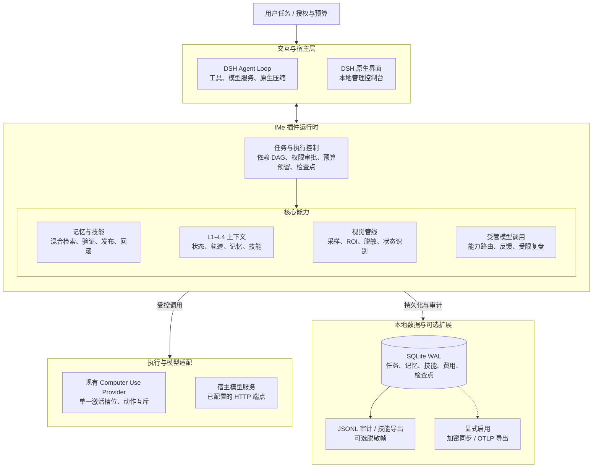

# IMe

**Intelligent Memory & Execution · 面向 DeepSeek Harness 的本地优先记忆与执行插件**


IMe 为 DeepSeek Harness（DSH）提供持久记忆、可复用技能、受控桌面执行和费用管理。它将任务中的观察、动作与结果保存为可追溯的经验，再通过检索和技能复用辅助后续任务。

插件沿用 DSH 的 Agent Loop、模型服务、原生上下文压缩和现有 Computer Use Provider，数据默认保存在本机。当前处于开发预览阶段，支持从源码安装；生产环境的兼容性与效果仍需在目标部署中验证。

[快速开始](#快速开始) · [技术架构](#技术架构) · [配置](#配置) · [文档](#文档) · [参与贡献](#参与贡献)

## 功能特性

| 能力 | 说明 |
| --- | --- |
| 持久记忆 | FTS5 与本地向量混合检索，支持应用隔离、有效期、候选审核和事实冲突处理。 |
| 技能学习 | 从成功轨迹提炼候选，支持有限参数、独立验证、版本发布、A/B 对比、退化回滚和依赖校验。 |
| 任务编排 | 持久化任务状态机、依赖 DAG、就绪队列和子任务，支持暂停、取消、检查点与重启恢复。 |
| 受控执行 | 复用已安装的桌面 Provider，通过应用白名单、动作目录、一次性审批和结果断言控制执行。 |
| 视觉处理 | 支持 PNG、宿主附件与灰度帧，提供 ROI、脱敏、变化检测、关键帧限频及按需模型检查。 |
| 上下文管理 | 按 L1–L4 分层组织任务状态、近期轨迹、记忆和技能，按配额召回并配合宿主原生压缩。 |
| 费用与预算 | 记录用量和报价快照，提供任务、会话、日、账户四级预算预留、结算与未知账单对账。 |
| 模型路由与复盘 | 按能力、隐私、预算和质量反馈选择受管请求的模型，提供有次数与费用上限的复盘。 |
| 管理与审计 | 提供 DSH 原生界面和本地控制台，支持 SQLite 账本、JSONL 审计、诊断导出及验收对账。 |
| 可选扩展 | 支持加密同步、同步资料待审和 OTLP 遥测导出，均需显式配置。 |

## 技术架构



典型流程是「观察 → 检索记忆与技能 → 预算及权限检查 → 执行 → 断言与检查点 → 经验沉淀」。技能候选经过验证和发布后才能复用；同步导入的知识重新进入待审区。

IMe 不注册第二个桌面 Provider。多个已安装驱动可配置映射，执行时使用宿主当前激活的槽位；桌面动作保持互斥。模型工具不能修改授权、提高预算、批准敏感动作或发布技能。

## 快速开始

### 环境要求

- Node.js **≥ 24.9.0**，以及 npm。
- DeepSeek Harness **0.2.1-rc.5**；其他版本尚未验证。
- 如需控制真实桌面，需要已安装并授权的 Computer Use Provider，以及对应的动作映射。

### 获取源码并构建

```sh
git clone https://github.com/yan-istart/IMe.git
cd IMe
npm ci
npm run build
```

### 运行演示

无需安装 DSH，也无需配置模型凭据，即可运行模拟任务：

```sh
npm run demo
```

启动使用模拟桌面的管理控制台：

```sh
npm run demo:dashboard
```

命令会输出访问凭据文件 `dashboard.url` 的位置。在另一个终端中打开该文件对应的控制台：

```sh
npm run dashboard -- /absolute/path/to/dashboard.url
```

演示使用临时数据目录和模拟环境，不调用付费模型。按 `Ctrl+C` 结束演示。

### 安装到 DSH

在源码目录完成构建后，将插件添加到目标 Profile：

```sh
dsh plugin --profile desktop add /absolute/path/to/IMe
```

请将路径替换为实际源码目录；使用其他 Profile 时替换 `desktop`。macOS 桌面版的内置 CLI 位于：

```sh
"/Applications/DeepSeek Harness.app/Contents/Resources/runtime/cli/bin/dsh" plugin --profile desktop add /absolute/path/to/IMe
```

安装后重启 DeepSeek Harness，使客户端模块完成加载。桌面 Profile 由桌面应用启动。移动源码目录后，需要重新建立插件链接。项目当前以源码方式分发，npm 包设为 `private`。

### 打开管理界面

- **侧边栏 → IMe 状态**：查看任务、记忆、技能、审批和预算，暂停或重新允许执行。
- **设置 → IMe 设置**：配置应用白名单、任务预算、预算时区和模型报价。
- **对话回复末尾**：查看该轮次的费用与 Token 用量；未配置报价时不推算金额。

插件运行后，也可以打开本地控制台：

```sh
npm run dashboard
```

默认从 `~/.dsh/ime-v1/dashboard.url` 读取访问链接。控制台仅监听 `127.0.0.1`，使用访问口令并校验 Origin/Host；凭据文件权限为 `0600`。

## 配置

在目标 Profile 的用户 patch 中合并以下配置，保留已有内容：

```yaml
- id: ime-core
  config:
    dataDir: ~/.dsh/ime-v1
    allowApps: []
    taskDefaultLimit: '1000000'
    budgetTimezone: Asia/Shanghai
    dashboard:
      enabled: true
      port: 0
```

`allowApps` 默认为空；启用桌面执行前，需要授权应用并配置 `desktopAdapter` 或 `desktopAdapters`。仅填写应用名称不足以建立桌面动作映射。

金额采用**币种百万分之一的整数字符串**：`'1000000'` 表示记录币种的 1 个单位，不同币种分别核算。账本金额依据 Provider 用量和配置报价计算，账户实扣需要单独对账。设置页保存的配置会写入数据目录下的 `settings.json`，并优先于同名插件配置。

受管模型执行、模型视觉与复盘、同步和遥测需另行启用。IMe 的审计与费用数据默认保存在本机；云端模型推理仍会向相应服务发送必要上下文。插件 bundle 默认关闭宿主的产品改进 Session Log 上传，用户已有 patch 可能覆盖该默认值。

完整字段、桌面动作映射、模型报价、同步与遥测示例见 [配置与操作说明](docs/configuration.md) 和 [配置 Schema](docs/config.schema.json)。

## 开发与验证

```sh
npm ci
npm run check
```

`check` 依次执行源码、测试与示例的类型检查、自动化测试和构建。其他常用命令：

| 命令 | 用途 |
| --- | --- |
| `npm run typecheck` | 执行 TypeScript 类型检查。 |
| `npm test` | 运行自动化测试。 |
| `npm run build` | 构建到 `dist/`。 |
| `npm run test:host` | 在临时 DSH Profile 中验证插件加载、工具、Agent Loop、模型入口与卸载。 |
| `npm run benchmark` | 运行模拟动作、模型请求、重启恢复及技能复用基准。 |
| `npm run acceptance -- status` | 查看运行实例的验收状态；其他子命令见配置文档。 |

宿主验证优先使用 `DSH_BIN` 指定的 CLI，否则尝试 macOS 桌面版内置 CLI 和 PATH 中的 `dsh`：

```sh
DSH_BIN=/absolute/path/to/dsh npm run test:host
```

宿主验证使用隔离的测试 Provider，不操作生产桌面、不调用付费模型，也不修改日常 Profile。基准与宿主检查会更新 `docs/` 下的对应报告。

### 项目结构

```text
IMe/
├── src/
│   ├── core/             # 任务、费用、记忆、技能、视觉与持久化
│   ├── adapters/         # DSH、桌面、模型与网络适配
│   ├── web/              # 本地控制台及界面桥接
│   └── index.ts          # 插件入口
├── tests/                # 自动化测试
├── examples/             # 模拟任务与控制台示例
├── scripts/              # 宿主验证、基准与验收工具
├── docs/                 # 配置、设计对照、兼容性及验证报告
├── client.js             # DSH 客户端界面
├── locale/               # 界面语言资源
└── cordis.patch.yml      # 插件 bundle 配置
```

## 文档

| 文档 | 内容 |
| --- | --- |
| [设计说明书](IMe_插件开发设计说明书_v1.0.md) | 目标、需求与设计方案。 |
| [设计逐项对照](docs/design-coverage.md) | F-01 至 F-11 的实现入口、验证结果与边界。 |
| [配置与操作](docs/configuration.md) | 安装后的配置、桌面映射和扩展操作。 |
| [学习与经验累积](docs/learning.md) | 记忆采集、技能候选、验证、发布与复用。 |
| [模型入口与预算](docs/model-gateway.md) | 模型接入、费用结算与预算保护范围。 |
| [宿主兼容性](docs/compatibility.md) | 已验证的 DSH 版本与可选服务能力。 |
| [验收报告](docs/acceptance.md) | 测试证据、基准与生产验收条件。 |
| [开发说明](docs/development.md) | 实现细节与开发记录。 |
| [插件整合](docs/plugin-integration.md) | 与宿主及其他插件的协作方式。 |
| [依赖与许可证](docs/dependencies.md) / [SBOM](docs/sbom.cdx.json) | 第三方来源、依赖版本与许可信息。 |

## 当前验证范围

已记录的验证包括 137 项自动化测试、14 项真实 DSH 宿主检查，以及 1000 个模拟动作、100 个模拟请求、20 次重启和 20 类模拟工作流的基准。具体条件和报告见 [设计逐项对照](docs/design-coverage.md) 与 [验收报告](docs/acceptance.md)。

- **桌面兼容性**：自动化验证使用隔离 Provider 和模拟环境，不能据此推断任意真实应用均可用；生产执行需要核实目标驱动、权限与动作映射。
- **预算保护**：当前报告 `hardLimit=false`。受管 HTTP 请求具有预算门禁，但不承诺所有 Provider 的内部重试、隐藏计费或其他插件调用都不可绕过。
- **模型与检索**：普通会话的模型选择由宿主掌握；默认本地向量使用字符与词 n-gram 哈希特征。可选的外部模型或向量能力需独立配置。
- **效果验收**：模拟基准不等于生产降本。60–120 分钟真实桌面长任务、账户实扣及实际成本变化仍需在目标环境验收。

## 卸载与数据管理

```sh
dsh plugin --profile desktop remove dsh-ime
```

卸载后重启宿主。用户数据默认保留在 `~/.dsh/ime-v1`；备份前先禁用插件、等待数据库关闭，再复制整个数据目录，包括可能存在的 WAL/SHM 文件。

异常退出后，只有在确认关联进程已停止时才可人工清理遗留锁。不确定动作需要核对，重启不会自动重放。恢复细节见 [配置与操作说明](docs/configuration.md#备份与恢复)。

## 参与贡献

欢迎通过 [Issues](https://github.com/yan-istart/IMe/issues) 报告问题或讨论功能，通过 [Pull Requests](https://github.com/yan-istart/IMe/pulls) 提交改进。

1. Fork 仓库并创建修改分支。
2. 实现修改；行为变化请补充相应测试，并同步相关文档。
3. 运行 `npm run check`；涉及宿主适配时，再运行 `npm run test:host`。
4. 提交 PR，说明问题、修改后的行为和验证结果。

问题报告请提供 Node.js 与 DSH 版本、复现步骤和脱敏诊断。不要提交 API Key、`dashboard.url`、本地数据库、截图中的私人信息或未脱敏审计记录。

## 许可证

项目尚未指定许可证，仓库当前未提供根目录 `LICENSE` 文件；使用和分发授权需由项目所有者明确。第三方依赖及参考来源的许可信息见 [依赖与来源记录](docs/dependencies.md)。
